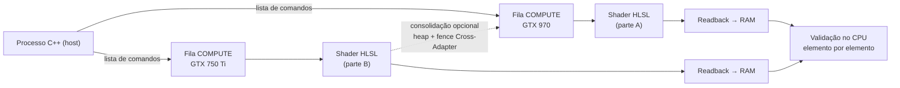

# NEXO DUAL GPU LAB

Laboratório de pesquisa sobre computação heterogênea com **duas GPUs NVIDIA diferentes no mesmo PC**, usando Direct3D 12, filas COMPUTE independentes, recursos Cross-Adapter e fences.

> **Versão:** [`0.1.0-alpha.1`](VERSION) · **Estado:** alpha experimental · **Repositório:** privado · **Licença:** não definida (não redistribuir)
> English summary: [README.en.md](README.en.md)

## Resumo executivo

- Duas GPUs (GTX 970 e GTX 750 Ti) executaram trabalho D3D12 ao mesmo tempo, cada uma com seu dispositivo e sua fila, com **todos os resultados conferidos no CPU**.
- Dados foram trocados entre as placas por recursos e fences Cross-Adapter, **nos dois sentidos**, sem divergências.
- Num workload sintético (gerar N inteiros e copiá-los para a memória do sistema), dividir o trabalho entre as duas GPUs reduziu o tempo mediano em **28,6% a 50,4%**.
- **Consolidar** o resultado numa única GPU custou mais do que o ganho em todas as cargas medidas.
- A auditoria independente ([docs/audit](docs/audit/claude-audit-2026-11-19.md)) e uma sonda física posterior ([Fase 3b](docs/phase3b-probe-report.md)) indicam que esse ganho vem de **dois links PCIe copiando em paralelo**, não de computação: sem a cópia, o dual foi 44% mais lento; em computação pesada, a GTX 750 Ti é cerca de 3 vezes mais lenta.

**Não é** SLI, NVLink, VRAM unificada nem renderização multi-GPU de jogos. **Não há** ganho de FPS: no [teste com Forza Horizon 4](docs/fh4-test-2026-11-19.md), 85 FPS só com a 970 e 86 FPS com as duas placas habilitadas; o jogo usa uma placa e o gargalo é a CPU.

## Problema de pesquisa

Duas GPUs de capacidades diferentes, instaladas no mesmo computador antigo, podem dividir uma carga de forma útil quando a aplicação controla tudo explicitamente? Quanto custa sincronizar e juntar os resultados?

Objetivos: (1) confirmar o que o hardware e o Windows permitem; (2) executar trabalho real nas duas placas com validação; (3) medir quando dividir compensa e quanto custa consolidar; (4) preparar um escalonador baseado em medições.

## Hardware e ambiente

| Item | Valor (evidência: [Fase 1](docs/phase1-hardware-report.md)) |
|---|---|
| CPU | Intel Core i7-3770K (Ivy Bridge, 4 núcleos / 8 threads, sem AVX2) |
| RAM | 32 GiB DDR3-1600 (4 × 8 GiB) |
| Placa-mãe | Gigabyte Z77X-UP5 TH, BIOS F12 (2014) |
| GPU 0 | NVIDIA GeForce GTX 970, 4 GiB, Maxwell GM204, feature level 12_1 |
| GPU 1 | NVIDIA GeForce GTX 750 Ti, 4 GiB, Maxwell GM107, feature level 11_0 |
| Sistema | Windows 11 Pro 64 bits, driver NVIDIA 582.78, WDDM 3.2 |
| Link PCIe | **Gen1 x8** nas duas durante as Fases 1–3; **Gen3 x8** nas leituras da Fase 4B. A causa da mudança não está documentada. |

Detalhes: [docs/hardware-and-environment.md](docs/hardware-and-environment.md).

## Arquitetura



Mais diagramas e o fluxo da transferência: [docs/architecture.md](docs/architecture.md).

## Fases

| Fase | Estado | O que entrega | Relatório |
|---|---|---|---|
| 1 — Diagnóstico | Concluída | Inventário DXGI/D3D12/CUDA; abertura de heap Cross-Adapter | [phase1](docs/phase1-hardware-report.md) |
| 2 — Prova de conceito | Concluída | Compute simultâneo validado; Cross-Adapter bidirecional | [phase2](docs/phase2-report.md) |
| 3 — Otimização | Concluída | 1.200 + 500 medições; divisões 50/50 a 70/30 | [phase3](docs/phase3-report.md) |
| 3b — Sonda | Exploratória (2026-11-19) | Computação vs. cópia; link Gen3 x8 | [phase3b](docs/phase3b-probe-report.md) |
| 4 — Monitoramento passivo | **Em andamento** | Coleta a cada 30 s; dados ainda não importados | [ACTIVE-LOGS](phases/phase4-monitoring/ACTIVE-LOGS.md) |
| 4B — PCIe | Validação inicial | Counters NVML ainda não confiáveis; nenhum benchmark | [phase4b](docs/phase4b-pcie-report.md) |
| GPU Control | Interface testada | Grava uma política; **não existe Engine que a consuma** | [gpu-control](docs/gpu-control.md) |
| OBS | Planejamento | NVENC por GPU **não confirmado** | [obs](docs/obs-integration.md) |

Visão consolidada: [docs/phase-status.md](docs/phase-status.md).

## Resultados (Fase 3, workload sintético)

Fonte: [`benchmarks/phase3/`](benchmarks/phase3/). 20 medições por configuração, após 5 aquecimentos. IC de 95% por bootstrap calculado na auditoria ([analysis/](analysis/)).

| Elementos | Melhor divisão 970/750 Ti | GTX 970 sozinha, mediana | Duas GPUs em paralelo, mediana | Redução (IC 95%) | Paralelo + consolidação vs. 970 |
|---:|:---:|---:|---:|---:|---:|
| 1.000.000 | 65/35 | 3,373 ms | 2,408 ms | 28,6% (24,9–29,9) | 48,1% mais lento |
| 2.000.000 | 60/40 | 7,086 ms | 4,289 ms | 39,5% (36,7–41,3) | 38,3% mais lento |
| 4.000.000 | 50/50 | 13,272 ms | 6,586 ms | 50,4% (48,4–51,2) | 48,5% mais lento |
| 8.000.000 | 50/50 | 21,007 ms | 11,124 ms | 47,0% (46,3–54,9) | 76,1% mais lento |

```mermaid
xychart-beta
  title "Mediana do tempo total (ms) — Fase 3"
  x-axis ["1M", "2M", "4M", "8M"]
  y-axis "ms" 0 --> 24
  bar [3.373, 7.086, 13.272, 21.007]
  bar [2.408, 4.289, 6.586, 11.124]
```



*Barras: GTX 970 sozinha (primeira série) e duas GPUs em paralelo na melhor divisão (segunda série).*

**Como ler esses números:**

- O tempo medido inclui gravar comandos, executar o shader **e copiar o resultado para a memória do sistema**. O shader é muito leve. A taxa implícita (1,1 a 1,5 GB/s) é típica de um link PCIe Gen1 x8. A [Fase 3b](docs/phase3b-probe-report.md) confirmou: sem a cópia, não há ganho.
- Hoje o link está em Gen3 x8 e a GTX 970 sozinha faz 8M + cópia em 6,05 ms (21,0 ms na Fase 3). Os números da tabela valem para o estado Gen1.
- O IC só mede o ruído dentro de uma sessão. O baseline da GTX 970 variou entre blocos (até 21%), e a ordem das medições não foi aleatória.
- A soma "paralelo + consolidação" junta medianas de dois experimentos separados.
- Tudo isso está detalhado em [docs/audit/claude-audit-2026-11-19.md](docs/audit/claude-audit-2026-11-19.md) e em [docs/research-methodology.md](docs/research-methodology.md).

## Como compilar e reproduzir

Requisitos: Windows 10/11 x64, duas GPUs NVIDIA com D3D12, Visual Studio Build Tools com MSVC, Windows SDK 10.0.26100 (inclui `fxc`).

```powershell
# Verificações estáticas (não usam GPU)
powershell -NoProfile -File scripts/static-checks.ps1
python -I analysis/reanalyze_phase3.py

# Compilação (ajuste o caminho do VsDevCmd.bat em build.ps1 se necessário)
powershell -NoProfile -File phases/phase3-optimization/source/build.ps1
```

Executar benchmarks usa as GPUs físicas e precisa de autorização do proprietário. Passo a passo, riscos e o que registrar: [docs/reproducibility.md](docs/reproducibility.md). Matriz do que foi e não foi testado: [docs/test-matrix.md](docs/test-matrix.md).

## Estrutura

```text
benchmarks/          CSVs históricos das Fases 2–3 (não editar)
phases/              fontes e evidências por fase
analysis/            reanálise independente (somente leitura dos CSVs)
docs/                relatórios, arquitetura, método, auditoria, FAQ
docs/audit/          auditorias independentes
scripts/             validação de versão e verificações estáticas
planning/            roadmap e revisão de publicação
.github/workflows/   CI estático (não valida Multi-GPU)
```

Índice completo da documentação: [docs/index.md](docs/index.md).

## Limitações

- Workload sintético e leve; não representa jogos, renderização ou um motor gráfico.
- Uma única sessão de medição por configuração; ordem não aleatória.
- Tempos medidos pelo relógio do host, sem timestamps de GPU.
- Estado do link PCIe diferente entre campanhas.
- Logs brutos das Fases 2–3 e os dados da Fase 4 não estão versionados.
- Cross-Adapter não cria VRAM unificada: 4 GiB + 4 GiB não viram 8 GiB.

## Roadmap

Ver [planning/roadmap.md](planning/roadmap.md). Próximo passo científico: **Fase 3b**, com timestamps de GPU, ordem aleatória, várias sessões e o estado do link registrado em cada medição.

O **NEXO AI COUNCIL** é um projeto separado, em planejamento, e não faz parte deste repositório.

## Dependências, privacidade e licença

- Dependências: [docs/dependencies-and-licenses.md](docs/dependencies-and-licenses.md)
- Privacidade: [docs/privacy-review.md](docs/privacy-review.md)
- Versões: [docs/VERSIONING.md](docs/VERSIONING.md), [CHANGELOG.md](CHANGELOG.md), [VERSION_HISTORY.md](VERSION_HISTORY.md)
- Contribuição: [CONTRIBUTING.md](CONTRIBUTING.md)
- A licença ainda não foi escolhida pelo proprietário. Não redistribua.

## Referências técnicas

- Microsoft, [Multi-adapter systems (D3D12)](https://learn.microsoft.com/en-us/windows/win32/direct3d12/multi-engine)
- Microsoft, [Shared heaps / Cross-Adapter](https://learn.microsoft.com/en-us/windows/win32/direct3d12/shared-heaps)
- Microsoft, [ID3D12CommandQueue::Wait](https://learn.microsoft.com/en-us/windows/win32/api/d3d12/nf-d3d12-id3d12commandqueue-wait)
- Microsoft, [Timing (timestamp queries em D3D12)](https://learn.microsoft.com/en-us/windows/win32/direct3d12/timing)
- NVIDIA, [NVML Device Queries](https://docs.nvidia.com/deploy/nvml-api/latest/api/group__nvmlDeviceQueries.html)

**Menos promessa, mais CSV.**
