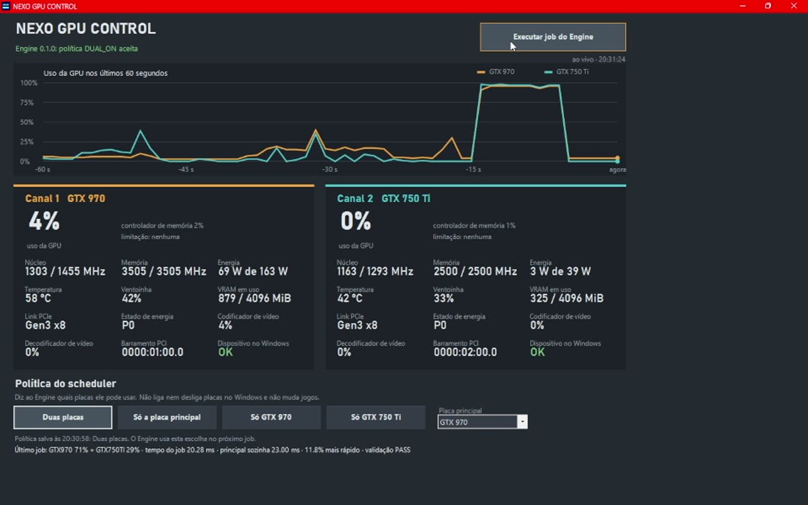
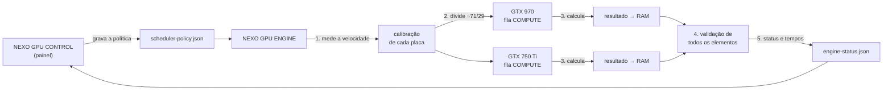
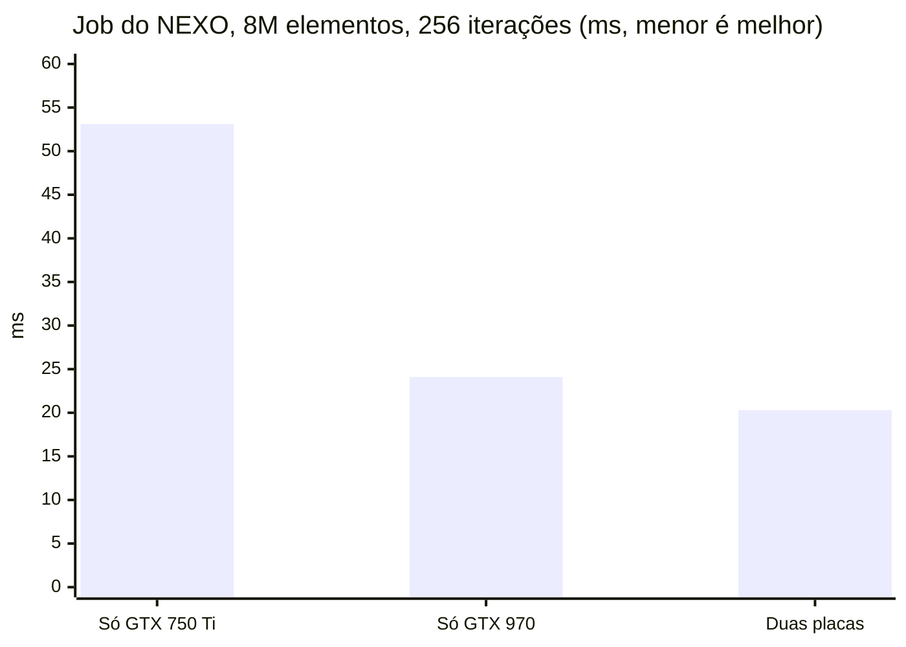
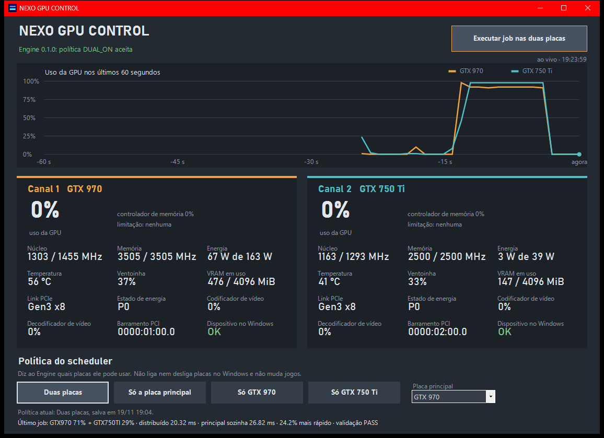
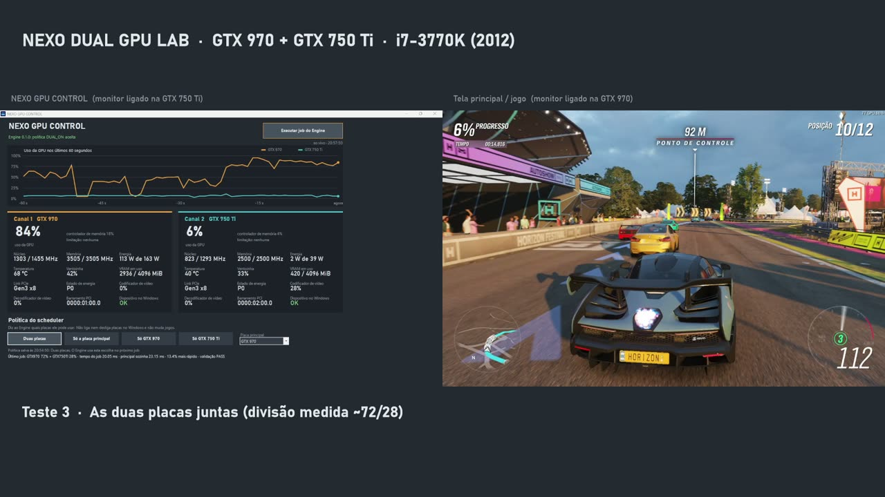

# NEXO DUAL GPU LAB

**Duas placas de vídeo de gerações diferentes trabalhando juntas num PC de 2012**, programadas à mão em C++ com Direct3D 12, com cada resultado conferido elemento por elemento e cada teste registrado, inclusive os que falharam.

> **Versão:** [`0.1.0-alpha.1`](VERSION) (mais o trabalho em andamento nos PRs) · **Estado:** laboratório experimental · **Repositório:** privado · **Licença:** ainda não escolhida (não redistribuir)
> English summary: [README.en.md](README.en.md) · Índice de toda a documentação: [docs/index.md](docs/index.md) · Diário de todos os testes: [docs/experiment-log.md](docs/experiment-log.md)



*O painel NEXO GPU CONTROL durante um job do NEXO GPU ENGINE: a curva âmbar (GTX 970) e a ciano (GTX 750 Ti) sobem juntas para ~95%. Embaixo: "GTX970 71% + GTX750Ti 29% · 20,28 ms · principal sozinha 23,00 ms · 11,8% mais rápido · validação PASS".*

---

## Sumário

1. [Em uma frase](#em-uma-frase)
2. [Resumo dos resultados](#resumo-dos-resultados)
   - [Teve melhora ou não?](#teve-melhora-ou-não)
   - [E com inteligência artificial?](#e-com-inteligência-artificial)
   - [Vídeos](#vídeos)
3. [O que este projeto é e o que não é](#o-que-este-projeto-é-e-o-que-não-é)
4. [O problema de pesquisa](#o-problema-de-pesquisa)
5. [O hardware](#o-hardware)
6. [Como as duas placas trabalham juntas](#como-as-duas-placas-trabalham-juntas)
7. [Linha do tempo das fases](#linha-do-tempo-das-fases)
8. [Resultados em detalhe](#resultados-em-detalhe)
9. [NEXO GPU ENGINE](#nexo-gpu-engine)
10. [NEXO GPU CONTROL](#nexo-gpu-control)
11. [Testes com jogo: Forza Horizon 4](#testes-com-jogo-forza-horizon-4)
12. [Gravação em vídeo (OBS)](#gravação-em-vídeo-obs)
13. [O que deu errado e o que aprendemos](#o-que-deu-errado-e-o-que-aprendemos)
14. [Como reproduzir](#como-reproduzir)
15. [Estrutura do repositório](#estrutura-do-repositório)
16. [Qualidade, testes e auditoria](#qualidade-testes-e-auditoria)
17. [Limitações conhecidas](#limitações-conhecidas)
18. [Próximos passos](#próximos-passos)
19. [Privacidade, dependências e licença](#privacidade-dependências-e-licença)
20. [Quem fez](#quem-fez)
21. [Referências técnicas](#referências-técnicas)

---

## Em uma frase

Num PC com uma GTX 970 e uma GTX 750 Ti, um programa próprio (o **NEXO GPU ENGINE**) mede a velocidade de cada placa, divide o trabalho na proporção certa (cerca de 71% para a 970 e 29% para a 750 Ti) e termina **de 10% a 26% mais rápido** do que a GTX 970 sozinha, com todos os resultados validados. Jogos não ganham FPS com isso, mas a segunda placa pode trabalhar ao lado do jogo, por exemplo gravando o vídeo.

## Resumo dos resultados

| Pergunta | Resposta | Evidência |
|---|---|---|
| As duas placas funcionam juntas no mesmo PC? | **Sim.** Cada uma com seu dispositivo e sua fila de comandos D3D12. | [Fase 1](docs/phase1-hardware-report.md), [Fase 2](docs/phase2-report.md) |
| Os resultados calculados estão corretos? | **Sim.** Todos os elementos de todas as rodadas são comparados com uma referência calculada no processador. | [Fase 2](docs/phase2-report.md), [Engine](docs/gpu-engine.md) |
| As placas conseguem trocar dados diretamente? | **Sim**, por memória compartilhada Cross-Adapter, nos dois sentidos. Mas é caro. | [Fase 2](docs/phase2-report.md), [Fase 3](docs/phase3-report.md) |
| Usar as duas deixa o cálculo mais rápido? | **Sim, de 10% a 26%**, mas só com a divisão certa (~71/29). Dividir 50/50 deixa tudo **mais lento**. | [Engine](docs/gpu-engine.md), [Teste 8](docs/experiment-log.md) |
| O "ganho de 50%" da Fase 3 era de cálculo? | **Não.** Vinha de duas conexões PCIe copiando dados ao mesmo tempo. Descoberto testando com e sem a cópia. | [Auditoria](docs/audit/claude-audit-2026-11-19.md), [Fase 3b](docs/phase3b-probe-report.md) |
| Duas placas aumentam o FPS de jogos? | **Não.** Forza Horizon 4: 85 FPS só com a 970 e 86 FPS com as duas habilitadas. O jogo usa uma placa só, e aqui o limite é o processador. | [Teste com Forza](docs/fh4-test-2026-11-19.md) |
| A segunda placa pode ajudar enquanto se joga? | **Sim, em outra função.** A GTX 970 roda o jogo e a GTX 750 Ti codifica a gravação do vídeo (encoder a 28%). | [Teste 12](docs/experiment-log.md) |
| Dá para ver isso acontecendo? | **Sim.** O painel NEXO GPU CONTROL mostra ao vivo todas as métricas das duas placas e tem um botão que roda o Engine. | [GPU Control](docs/gpu-control.md) |

## Teve melhora ou não?

Resposta curta, sem rodeio:

| Onde | Mudou? | Números | Leitura |
|---|---|---|---|
| **Cálculo feito por um programa preparado para isso** (NEXO GPU ENGINE) | **Sim, melhorou** | só a GTX 970: 23,6 ms → as duas: 20,3 ms. Ganho de **10% a 26%** conforme a rodada (média perto de **18%**) | ganho real, medido e validado. Modesto porque a GTX 750 Ti é ~3× mais fraca; o teto teórico com estas placas é ~25% |
| **Jogos** (Forza Horizon 4) | **Não mudou nada** | 85 FPS só com a 970 e 86 FPS com as duas | o jogo usa uma placa só, e aqui quem limita é o processador |
| **Jogar e gravar ao mesmo tempo** | **A segunda placa trabalha, mas o efeito no FPS ainda não foi medido** | encoder da 750 Ti a 28% enquanto a 970 roda o jogo; encoder da 970 em 0% | a divisão de funções acontece; falta comparar o FPS gravando com o encoder na 970 e na 750 Ti |
| **"Ganho de 50%" da Fase 3** | **Era ilusão de medição** | sem a cópia de dados, as duas juntas foram 44% mais lentas | vinha das duas conexões PCIe copiando ao mesmo tempo, não de cálculo |

Em uma frase: **duas placas ajudam programas feitos para dividir o trabalho (~18% aqui); jogos não ganham nada.**

## E com inteligência artificial?

IA é um caso muito mais favorável que jogos, porque o programa decide onde cada parte roda. Há três formas de usar duas placas, **ainda não medidas neste laboratório**:

| Forma | Como funciona | O que se ganha | Cuidado |
|---|---|---|---|
| **Uma tarefa por placa** | ex.: o modelo de conversa na GTX 970; reconhecimento de voz e embeddings na GTX 750 Ti | as tarefas não disputam a mesma placa nem a mesma VRAM | é a forma mais simples e a mais estável |
| **Dividir lotes de trabalho** (como o Engine) | um lote de embeddings ou de imagens dividido ~71/29 pela velocidade de cada placa | mais itens por segundo, na mesma lógica dos 10–26% medidos | só vale para trabalho que pode ser separado em pedaços independentes |
| **Um modelo grande dividido entre as duas** | as camadas do modelo ficam parte na 970 e parte na 750 Ti | cabe um modelo maior do que 4 GB, sem usar a RAM do sistema | não fica mais rápido (as camadas rodam em sequência e conversam pelo PCIe) e a placa mais fraca pode virar gargalo |

Observação de um projeto separado do autor (um assistente de voz local, fora deste repositório e sem dados versionados aqui): a primeira forma está em uso, com o modelo de conversa na GTX 970 e voz e embeddings na GTX 750 Ti. Uma tentativa da terceira forma, com um modelo de 8B dividido enquanto a voz também usava a 750 Ti, deixou a voz muito mais lenta, porque a placa lotou. Por isso a próxima campanha deste laboratório é medir a segunda forma (lotes divididos) com dados versionados.

## Vídeos

Clipes curtos (720p, ~15–18 s), gravados em 2026-11-19 com o painel NEXO GPU CONTROL e a tela do jogo. Clique para assistir no GitHub.

| Clipe | O que mostra | Resultado na tela |
|---|---|---|
| [Só a GTX 970](docs/assets/videos/01-so-gtx970.mp4) | job do Engine com a política "Só GTX 970": só a curva âmbar sobe | 23,6 ms |
| [Só a GTX 750 Ti](docs/assets/videos/02-so-gtx750ti.mp4) | o mesmo job só na 750 Ti: só a curva ciano sobe | 57,9 ms |
| [As duas juntas](docs/assets/videos/03-duas-placas.mp4) | divisão 71/29: as duas curvas sobem juntas | 20,3 ms, 11,8% mais rápido |
| [Forza na GTX 970](docs/assets/videos/04-forza-gtx970.mp4) | o jogo usa a 970; a 750 Ti fica parada | uma placa só |
| [Forza na GTX 750 Ti](docs/assets/videos/05-forza-gtx750ti.mp4) | o jogo escolhido para rodar na 750 Ti (99% de uso na largada) | a placa escolhida no Windows trabalha |
| [Forza na 970 + 750 Ti gravando](docs/assets/videos/06-forza-970-joga-750-grava.mp4) | a 970 roda o jogo e a 750 Ti codifica a gravação | as duas, cada uma numa função |

Os trechos do Engine mostram o painel ampliado; a segunda tela estava sem conteúdo nesses momentos. Como foram gravados e editados: [docs/obs-recording.md](docs/obs-recording.md) e Teste 12 do [diário](docs/experiment-log.md).

## O que este projeto é e o que não é

**É:**
- um laboratório para entender, medir e documentar o uso explícito de duas GPUs diferentes;
- um motor próprio (Engine) que divide trabalho de computação do NEXO entre as placas;
- um painel (GPU Control) que mostra o estado das duas placas e dispara o Engine;
- um conjunto de dados (CSVs) e relatórios que qualquer avaliador pode conferir.

**Não é:**
- **SLI** nem **NVLink**: as placas não são ligadas por ponte, e são de modelos diferentes;
- **VRAM unificada**: 4 GB + 4 GB **não** viram 8 GB. Cada placa tem sua memória;
- um **acelerador de jogos**: jogos escolhem sozinhos qual GPU usar e não dividem o trabalho;
- um produto pronto: é alpha e experimental.

## O problema de pesquisa

Muita gente tem uma placa de vídeo antiga parada na gaveta ao trocar de placa. A pergunta deste laboratório é:

> **Duas GPUs de capacidades diferentes, no mesmo computador antigo, conseguem dividir uma carga de forma útil quando a aplicação controla tudo explicitamente? Quanto custa sincronizar e juntar os resultados?**

Objetivos:

1. confirmar o que o hardware, o driver e o Windows permitem;
2. executar trabalho real nas duas placas, com validação total dos resultados;
3. medir quando dividir compensa, em que proporção, e quanto custa juntar os resultados;
4. construir um escalonador (o Engine) baseado em medições, não em achismo;
5. registrar tudo de forma que um professor ou pesquisador consiga auditar sem precisar de explicação.

Princípio do laboratório: **menos promessa, mais CSV**. Publicar o experimento honesto, mesmo quando o resultado mostra que uma placa sozinha é melhor.

## O hardware

| Componente | Detalhe | Evidência |
|---|---|---|
| Processador | Intel Core i7-3770K, Ivy Bridge (2012), 4 núcleos / 8 threads, 3,5 GHz (até 3,9), sem AVX2 | [Fase 1](docs/phase1-hardware-report.md) |
| Memória | 32 GiB DDR3-1600 (4 × 8 GiB Corsair) | [Fase 1](docs/phase1-hardware-report.md) |
| Placa-mãe | Gigabyte Z77X-UP5 TH, BIOS F12 (2014) | [Fase 1](docs/phase1-hardware-report.md) |
| Sistema | Windows 11 Pro 64 bits, driver NVIDIA 582.78, WDDM 3.2 | [Fase 1](docs/phase1-hardware-report.md) |
| **GPU 1 — GTX 970** | Maxwell GM204, 1.664 núcleos CUDA, 4 GiB, Direct3D feature level 12_1, NVENC H.264/HEVC | [hardware](docs/hardware-and-environment.md) |
| **GPU 2 — GTX 750 Ti** | Maxwell GM107, 640 núcleos CUDA, 4 GiB, feature level 11_0, NVENC H.264 | [hardware](docs/hardware-and-environment.md) |
| Monitores | SyncMaster na GTX 970 (principal); LG L192WS na GTX 750 Ti; ambos 1440×900 | [OBS](docs/obs-recording.md) |
| Ligação PCIe | **Gen1 x8** nas duas durante as Fases 1–3; **Gen3 x8** desde a Fase 4B. A mudança não tem causa registrada. | [hardware](docs/hardware-and-environment.md) |

Em computação pura, medida neste PC, a **GTX 750 Ti é cerca de 3 vezes mais lenta** que a GTX 970 (183 ms contra 60 ms no mesmo trabalho pesado). Por isso a divisão ideal não é meio a meio.

## Como as duas placas trabalham juntas



Passo a passo:

1. **Encontrar as placas.** O Windows lista os adaptadores pelo DXGI. O Engine reconhece cada placa pelo código do modelo (DeviceId `13C2` = GTX 970, `1380` = GTX 750 Ti), nunca pela posição na lista.
2. **Preparar cada placa.** Para cada uma: um dispositivo Direct3D 12, uma fila de comandos de computação (COMPUTE), uma área de memória na placa para o resultado e outra na RAM para lê-lo.
3. **Calibrar.** Cada placa faz sozinha 1/8 do trabalho; o tempo por elemento define a fatia de cada uma.
4. **Dividir e executar ao mesmo tempo.** A GTX 970 calcula os primeiros ~71% dos elementos e a GTX 750 Ti os ~29% restantes. As duas filas recebem o trabalho antes de o processador esperar por qualquer uma.
5. **Validar.** O processador recalcula cada elemento e compara. Uma única diferença faz o job falhar.
6. **Comparar com a 970 sozinha.** Na mesma execução, alternando a ordem (A B B A), com uma rodada de aquecimento não cronometrada antes de cada medição.

O trabalho de teste é um shader HLSL determinístico: para cada elemento, embaralha bits por 8 a 1.024 iterações. Ele é sintético de propósito: fácil de validar e de ajustar o peso.

Mais diagramas (inclusive da troca de dados Cross-Adapter): [docs/architecture.md](docs/architecture.md).

## Linha do tempo das fases

| Fase | Estado | O que fez | Resultado principal | Relatório |
|---|---|---|---|---|
| 1 — Diagnóstico | Concluída | Inventário de CPU, RAM, placa-mãe, PCIe, DXGI, D3D12 e CUDA | As duas placas criam dispositivos e filas D3D12; memória Cross-Adapter abre nos dois sentidos | [phase1](docs/phase1-hardware-report.md) |
| 2 — Prova de conceito | Concluída | Cálculo simultâneo nas duas placas + troca de 1 MiB entre elas com fences | Tudo validado; sem ganho sobre a 970 sozinha nesse trabalho pequeno | [phase2](docs/phase2-report.md) |
| 3 — Otimização | Concluída | 1.200 medições de cálculo + 500 de transferência, divisões de 50/50 a 70/30 | 28,6% a 50,4% mais rápido, depois explicado como cópia em paralelo | [phase3](docs/phase3-report.md) |
| Auditoria | Concluída | Revisão independente de dados, código e documentação | Números certos, interpretação errada; 23 achados classificados | [auditoria](docs/audit/claude-audit-2026-11-19.md) |
| 3b — Sonda | Exploratória | Mesmo cálculo com e sem a cópia, 8 e 1.024 iterações | Sem cópia, o dual foi 44% mais lento; a 750 Ti é ~3× mais lenta | [phase3b](docs/phase3b-probe-report.md) |
| 4 — Monitoramento passivo | Em andamento | Temperatura, clocks, uso e memória a cada 30 s | Coleta ativa; dados ainda não importados | [Fase 4](phases/phase4-monitoring/ACTIVE-LOGS.md) |
| 4B — PCIe | Validação inicial | Contadores de tráfego PCIe pelo NVML | 3 de 8 leituras impossíveis; coletor com defeito; nada concluído | [phase4b](docs/phase4b-pcie-report.md) |
| **GPU Engine** | **v0.1 funcional** | Calibração + divisão proporcional + validação | **10% a 26% mais rápido** que a 970 sozinha | [gpu-engine](docs/gpu-engine.md) |
| **GPU Control** | **v2.1 testada** | Painel de dois canais com todas as métricas e botão do Engine | Clique responde em ≤175 ms; mostra as duas placas trabalhando | [gpu-control](docs/gpu-control.md) |
| Teste com jogo | Feito | Forza Horizon 4 com uma e com duas placas | 85 vs. 86 FPS; o jogo usa uma placa | [Forza](docs/fh4-test-2026-11-19.md) |
| Gravação (OBS) | Configurada | Dois monitores num vídeo, 5 cenas, atalhos de teclado | Gravar sem atrapalhar a medição exige o OBS minimizado | [OBS](docs/obs-recording.md) |

Estado consolidado de tudo (demonstrado, planejado, não testado): [docs/phase-status.md](docs/phase-status.md).

## Resultados em detalhe

### 1. NEXO GPU ENGINE: o ganho real de computação

Job: 8 milhões de elementos, todos validados. Divisão calibrada automaticamente pelo Engine.

| Teste | Iterações por elemento | Divisão 970/750 Ti | Duas placas | GTX 970 sozinha | Ganho |
|---|---:|:---:|---:|---:|---:|
| Teste 8, sessão 1 | 256 | 71/29 | 20,9 ms | 25,7 ms | 18,7% |
| Teste 8, sessão 2 | 256 | 72/28 | 20,7 ms | 23,1 ms | 10,3% |
| Teste 8, sessão 3 | 1.024 | 75/25 | 50,5 ms | 66,2 ms | 23,7% |
| Teste 8, sessão 4 | 1.024 | 74/26 | 53,1 ms | 66,0 ms | 19,5% |
| Teste 9 (botão do painel) | 256 | 71/29 | 20,3 ms | 26,8 ms | 24,2% |
| Teste 11 (OBS minimizado) | 256 | 71/29 | 17,5 ms | 23,8 ms | 26,5% |
| Teste 12 (gravação do vídeo) | 256 | 71/29 | 20,3 ms | 23,0 ms | 11,8% |

E cada placa sozinha, no mesmo job (Testes 10 e 12):

| Política | Tempo |
|---|---:|
| Só GTX 970 | 20,3 a 24,1 ms |
| Só GTX 750 Ti | 51,8 a 57,9 ms |
| As duas juntas (~71/29) | 17,5 a 20,9 ms |



O máximo teórico, somando as velocidades medidas, é ~25% de ganho. Os resultados ficam perto disso. A variação entre sessões (10% a 26%) vem principalmente do clock das placas, que sobe e desce sozinho.

Dados brutos: [`data/gpu-engine/2026-11-19/engine-runs.csv`](data/gpu-engine/2026-11-19/engine-runs.csv), com a coluna `validity` marcando inclusive a execução inválida.

### 2. Fase 3: o "ganho de 50%" e por que ele enganava

Fonte: [`benchmarks/phase3/`](benchmarks/phase3/). 20 medições por configuração, após 5 aquecimentos. Intervalo de confiança de 95% por bootstrap, calculado na auditoria ([analysis/](analysis/)).

| Elementos | Melhor divisão 970/750 Ti | GTX 970 sozinha | Duas em paralelo | Redução (IC 95%) | Paralelo + juntar o resultado |
|---:|:---:|---:|---:|---:|---:|
| 1.000.000 | 65/35 | 3,373 ms | 2,408 ms | 28,6% (24,9–29,9) | 48,1% mais lento |
| 2.000.000 | 60/40 | 7,086 ms | 4,289 ms | 39,5% (36,7–41,3) | 38,3% mais lento |
| 4.000.000 | 50/50 | 13,272 ms | 6,586 ms | 50,4% (48,4–51,2) | 48,5% mais lento |
| 8.000.000 | 50/50 | 21,007 ms | 11,124 ms | 47,0% (46,3–54,9) | 76,1% mais lento |

Por que esses números não medem computação:

- O tempo incluía **copiar o resultado para a RAM pelo PCIe**, e o cálculo era leve (8 iterações).
- A taxa implícita (1,1 a 1,5 GB/s) bate com uma ligação PCIe Gen1 x8.
- A GTX 750 Ti empatava com a GTX 970 nos tamanhos grandes, o que não acontece num gargalo de cálculo.
- Teste decisivo ([Fase 3b](docs/phase3b-probe-report.md)): **sem a cópia, as duas juntas foram 44% mais lentas**; com a cópia, 23% mais rápidas.

Conclusão: o ganho vinha das **duas conexões PCIe copiando ao mesmo tempo**. É um resultado real, mas de outra coisa. O Engine corrigiu o desenho: divide pela velocidade de cálculo e mede com aquecimento e ordem alternada.

### 3. Juntar os resultados numa placa só

Mandar a parte da GTX 750 Ti para a GTX 970 (pela memória compartilhada Cross-Adapter) custou mais do que o ganho em todas as cargas da Fase 3 (38% a 76% mais lento que a 970 sozinha). Ressalva da auditoria: esse número soma medianas de dois experimentos separados e inclui um salto extra até a RAM. Para uma aplicação real, a regra prática é **deixar cada resultado na placa que o calculou** sempre que possível.

## NEXO GPU ENGINE

- Fonte: [`phases/gpu-engine/source/NexoGpuEngine.cpp`](phases/gpu-engine/source/NexoGpuEngine.cpp) (C++17, Direct3D 12, sem bibliotecas de terceiros).
- Documentação: [docs/gpu-engine.md](docs/gpu-engine.md).

O que faz:
- lê e valida a política gravada pelo painel e **recusa** política inconsistente ou que peça mudança de hardware;
- **DRY RUN** por padrão: só confirma a política e mostra o plano, sem usar as placas;
- com `--run`: calibra, divide, executa, valida tudo, compara com a placa principal sozinha e grava `engine-status.json` e `engine-runs.csv`;
- `--sustain S`: mantém as placas ocupadas por S segundos depois da medição, só para visualizar no painel (fora das estatísticas).

O que não faz: não acelera jogos, não mexe em drivers, clocks, registro ou BIOS, e não liga nem desliga placas.

## NEXO GPU CONTROL



- Fonte: [`phases/gpu-control/source/NexoGpuControl.ps1`](phases/gpu-control/source/NexoGpuControl.ps1) (PowerShell + Windows Forms).
- Documentação: [docs/gpu-control.md](docs/gpu-control.md).

Mostra ao vivo, para cada placa: uso da GPU e do controlador de memória, clock do núcleo e da memória (atual e máximo), energia contra o limite, temperatura, ventoinha, VRAM, ligação PCIe, estado de energia, codificador e decodificador de vídeo, barramento, estado no Windows e motivo de limitação de clock. A faixa de cima sobrepõe as curvas de uso das duas placas nos últimos 60 s (âmbar = GTX 970, ciano = GTX 750 Ti).

Botões de política: **Duas placas**, **Só a placa principal**, **Só GTX 970**, **Só GTX 750 Ti**. O botão **Executar job do Engine** roda o Engine com a política escolhida.

Histórico de versões:

| Versão | Mudança | Medido |
|---|---|---|
| v1.0 (Codex) | Primeira interface; política local | Clique levava até 12 s ou mais de 30 s; janela não fechava |
| v1.1 | Telemetria em segundo plano; placas por DeviceId; instância única | Clique em 31–175 ms; fecha em 87 ms |
| v2.0 | Painel de dois canais com todas as métricas; botão do Engine | Duas curvas a ~95% por 10 s; 24,2% mais rápido |
| v2.1 | Abre no monitor da 750 Ti; botão funciona com qualquer política | Testado nas três políticas |

## Testes com jogo: Forza Horizon 4



| Teste | Configuração | O que o painel mostrou | Conclusão |
|---|---|---|---|
| 3 | Jogo na GTX 970 | 85 FPS; 750 Ti parada (2 W) | uma placa só |
| 4 | "Duas placas" habilitadas | 86 FPS; 750 Ti parada (1 W) | o jogo ignora a segunda placa |
| 12a | Jogo na GTX 970, gravando | 970 a 85%, 117 W; 750 Ti parada (1 W) | o normal: uma placa |
| 12b | Jogo forçado na GTX 750 Ti | 750 Ti a 64%, 20 W | o jogo roda na placa escolhida no Windows |
| 12c | Jogo na 970, **750 Ti codificando a gravação** | 970 a 84%, 113 W; encoder da 750 Ti a 28% | **as duas trabalhando juntas, cada uma numa função** |

O benchmark do jogo mostrou que o limite de FPS aqui é o processador: renderização da CPU ~90 FPS contra ~111 FPS da GPU, e menos de 1% do tempo limitado pela GPU. Detalhes: [docs/fh4-test-2026-11-19.md](docs/fh4-test-2026-11-19.md).

## Gravação em vídeo (OBS)

O vídeo do laboratório grava os dois monitores lado a lado (1920×1080, 30 fps), com cinco cenas legendadas: só GTX 970, só GTX 750 Ti, duas placas, Forza na 970 e Forza na 750 Ti. Atalhos: **Ctrl+Alt+R** grava, **Ctrl+Alt+S** para, **Ctrl+Alt+1…5** troca a cena.

Descoberta importante (Teste 11): **com a janela do OBS aberta no monitor da GTX 750 Ti, o Engine ficou 183% mais lento**, porque a prévia ao vivo disputava a placa com o cálculo. Com o OBS minimizado, o resultado voltou ao normal. Para a cena final, o codificador do OBS foi passado para a GTX 750 Ti (variante `obs_nvenc_h264_cuda`, GPU 1).

Configuração e roteiro: [docs/obs-recording.md](docs/obs-recording.md).

## O que deu errado e o que aprendemos

Registrado no [diário de experimentos](docs/experiment-log.md):

| Problema | Como apareceu | Solução |
|---|---|---|
| "Ganho de 50%" era cópia, não cálculo | Auditoria e Fase 3b | Engine mede e divide por velocidade de cálculo |
| Divisão 50/50 deixa tudo mais lento | Fase 3b, 1.024 iterações | Calibração automática (~71/29) |
| Clock da GPU cai entre medições | Teste 7: resultado mudou de sinal | Aquecimento não cronometrado antes de cada medição; ordem ABBA |
| Medição com jogo aberto | Teste 5 (−386%) | Marcada como inválida e mantida nos dados |
| Painel travava (v1.0) | Cliques de até 30 s | Telemetria em segundo plano (v1.1) |
| Coletor PCIe não gravava nada | Auditoria H4 | Documentado; correção pendente |
| Prévia do OBS atrapalhava o Engine | Teste 11 (+183%) | Gravar com o OBS minimizado |
| OBS abria na GPU errada | GPU de alto desempenho global trocada | OBS fixado em alto desempenho; captura WGC |

## Como reproduzir

### Sem placas de vídeo (qualquer avaliador)

```powershell
powershell -NoProfile -File scripts/static-checks.ps1   # conta e recalcula todos os CSVs, links, credenciais, sintaxe
python -I analysis/reanalyze_phase3.py                   # reanálise da Fase 3 com intervalos de confiança
```

### Compilar (Windows + Visual Studio Build Tools + Windows SDK 10.0.26100)

```powershell
phases/gpu-engine/source/build.cmd                                     # NEXO GPU ENGINE
powershell -NoProfile -File phases/phase3-optimization/source/build.ps1  # fontes da Fase 3 (gera compute.cso)
```

### Rodar nas placas (precisa de duas GPUs NVIDIA)

```powershell
NexoGpuEngine.exe                              # DRY RUN: só valida a política
NexoGpuEngine.exe --run                        # mede e valida
NexoGpuEngine.exe --run --iterations 1024 --reps 6
```

Feche jogos e gravadores antes de medir. Guia completo, cuidados e o que registrar: [docs/reproducibility.md](docs/reproducibility.md). Matriz do que foi e não foi testado: [docs/test-matrix.md](docs/test-matrix.md).

## Estrutura do repositório

```text
README.md, README.en.md     esta página e o resumo em inglês
docs/                       relatórios, arquitetura, método, diário, FAQ, glossário
docs/audit/                 auditoria independente
docs/assets/                imagens usadas na documentação
phases/phase1-diagnostic/   fontes e evidências do diagnóstico de hardware
phases/phase2-prototype/    prova de conceito D3D12
phases/phase3-optimization/ benchmark da Fase 3
phases/phase3b-probe/       sonda computação vs. cópia
phases/phase4-monitoring/   monitor passivo (sem os dados ativos)
phases/gpu-engine/          NEXO GPU ENGINE
phases/gpu-control/         NEXO GPU CONTROL e contrato da política
benchmarks/                 CSVs históricos das Fases 2–3 (nunca editados)
data/                       dados das campanhas novas (Fase 3b, Engine, Forza)
analysis/                   reanálise independente dos CSVs
tools/obs/                  gerador da configuração de gravação do OBS
scripts/                    validação de versão e verificações estáticas
planning/                   roadmap e revisão de publicação
.github/workflows/          CI estático (não testa as placas)
```

## Qualidade, testes e auditoria

- **Dados históricos nunca são editados.** Correções vão para documentos novos e para o [CHANGELOG](CHANGELOG.md).
- **Auditoria independente** com 23 achados (1 crítico, 5 altos), cada um com evidência, correção e como verificar: [docs/audit/claude-audit-2026-11-19.md](docs/audit/claude-audit-2026-11-19.md).
- **Verificações automáticas** a cada PR ([static-checks.yml](.github/workflows/static-checks.yml)): contagens e estatísticas dos CSVs, links, credenciais, caminhos absolutos, sintaxe PowerShell e integridade Git. O CI não tem placas de vídeo e **não** vale como teste multi-GPU.
- **Tipos de teste separados:** estático, compilação, físico com GPU, benchmark e validação externa, na [matriz de testes](docs/test-matrix.md).
- **Metodologia** e ameaças à validade: [docs/research-methodology.md](docs/research-methodology.md).

## Limitações conhecidas

- O trabalho testado é **sintético**: valida a técnica, não acelera aplicações reais por si só.
- Poucas sessões, todas no mesmo dia; ainda sem intervalo de confiança entre sessões para o Engine.
- O ganho depende do clock das placas e de outros programas usando a GPU.
- Tempos medidos pelo relógio do processador; os timestamps de GPU deste driver não isolaram a cópia.
- A ligação PCIe mudou de Gen1 para Gen3 entre campanhas; a Fase 3 não se reproduz no estado atual.
- Logs brutos das Fases 2–3 e os dados da Fase 4 ainda não estão versionados.
- Jogos não ganham FPS com duas placas.

## Próximos passos

Detalhe em [planning/roadmap.md](planning/roadmap.md).

1. Engine: mais sessões em horários diferentes, intervalo de confiança, mais tamanhos de trabalho.
2. Descobrir por que a ligação PCIe mudou de Gen1 para Gen3.
3. Corrigir o coletor de PCIe (Fase 4B) e validar os contadores.
4. Encerrar e importar a Fase 4, sem dados pessoais.
5. Medir o efeito da 750 Ti gravando o vídeo no FPS do jogo, com várias rodadas.

O **NEXO AI COUNCIL** (ChatGPT, Gemini e Claude com um orquestrador determinístico) é um **projeto separado**, em planejamento, com repositório e dados próprios. Nada dele está neste repositório.

## Privacidade, dependências e licença

- Repositório **privado**. Nenhuma credencial, hostname ou PID no histórico (auditado). Detalhes: [docs/privacy-review.md](docs/privacy-review.md).
- Dependências: Windows, Direct3D 12, Windows SDK, MSVC e driver NVIDIA, todos já instalados; nenhuma biblioteca de terceiros no código. [docs/dependencies-and-licenses.md](docs/dependencies-and-licenses.md).
- Versões: [docs/VERSIONING.md](docs/VERSIONING.md), [CHANGELOG.md](CHANGELOG.md), [VERSION_HISTORY.md](VERSION_HISTORY.md).
- Contribuição: [CONTRIBUTING.md](CONTRIBUTING.md).
- **Licença ainda não escolhida.** Não redistribua.

## Quem fez

- **Bruno Gadelha (NTH)**: idealização, direção, hardware e todos os testes físicos.
- **Codex / ChatGPT (OpenAI)**: diagnóstico e protótipos das Fases 1–3, monitoramento da Fase 4, primeira versão do GPU Control, versionamento.
- **Claude Code (Anthropic)**: auditoria independente, reanálise dos dados, Fase 3b, NEXO GPU ENGINE, GPU Control v1.1–v2.1, configuração de gravação e esta documentação.

Merge na `main` somente pelo Bruno.

## Referências técnicas

- Microsoft, [Multi-adapter systems (D3D12)](https://learn.microsoft.com/en-us/windows/win32/direct3d12/multi-engine)
- Microsoft, [Shared heaps / Cross-Adapter](https://learn.microsoft.com/en-us/windows/win32/direct3d12/shared-heaps)
- Microsoft, [ID3D12CommandQueue::Wait](https://learn.microsoft.com/en-us/windows/win32/api/d3d12/nf-d3d12-id3d12commandqueue-wait)
- Microsoft, [Timing (timestamp queries em D3D12)](https://learn.microsoft.com/en-us/windows/win32/direct3d12/timing)
- NVIDIA, [NVML Device Queries](https://docs.nvidia.com/deploy/nvml-api/latest/api/group__nvmlDeviceQueries.html)
- NVIDIA, [Video Encode and Decode Support Matrix](https://developer.nvidia.com/video-encode-decode-support-matrix)

---

**Menos promessa, mais CSV.**
