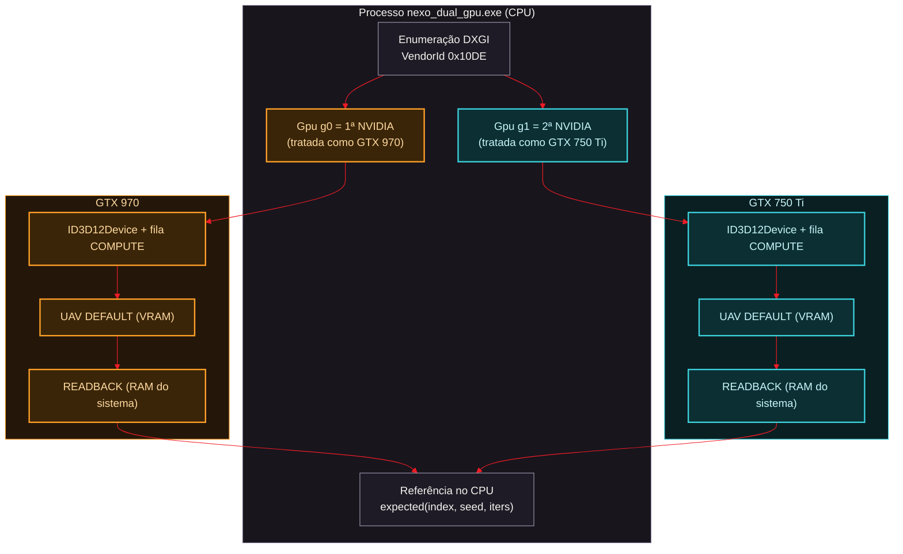
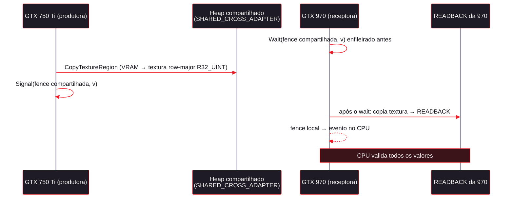
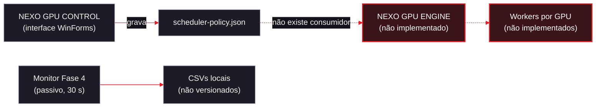

# Arquitetura

Descreve o que o código das Fases 2 e 3 faz de fato (fontes em `phases/phase2-prototype/source/` e `phases/phase3-optimization/source/`).

## 1. Componentes



Observações:

- A atribuição "g0 = GTX 970" depende da **ordem de enumeração** DXGI. O código não confere nome nem LUID (achado M1 da auditoria).
- Cada GPU tem seu próprio dispositivo, fila, fence local e evento Win32. Não há nó compartilhado (não é Linked Node / SLI).

## 2. Uma medição de "compute" (Fase 3)

```mermaid
%%{init: {"theme":"base","themeVariables":{"primaryColor":"#1f1b26","primaryTextColor":"#f4f2ee","primaryBorderColor":"#ee1c25","lineColor":"#ee1c25","secondaryColor":"#2a2533","tertiaryColor":"#1a1720","clusterBkg":"#18151d","clusterBorder":"#77708a","edgeLabelBackground":"#14121a","fontFamily":"Segoe UI, Arial, sans-serif","actorBkg":"#1f1b26","actorBorder":"#ee1c25","actorTextColor":"#f4f2ee","actorLineColor":"#9a94a8","signalColor":"#ee1c25","signalTextColor":"#14121a","noteBkgColor":"#3a1418","noteTextColor":"#f4f2ee","noteBorderColor":"#ee1c25","labelBoxBkgColor":"#1f1b26","labelBoxBorderColor":"#ee1c25","labelTextColor":"#f4f2ee","loopTextColor":"#f4f2ee","activationBkgColor":"#3a1418"}}}%%
sequenceDiagram
  participant CPU
  participant Q as Fila COMPUTE
  participant GPU
  participant RAM as RAM (READBACK)
  Note over CPU: t0 = qpc()
  CPU->>CPU: encode(): Dispatch + barreira + CopyBufferRegion
  CPU->>Q: ExecuteCommandLists + Signal(fence)
  Q->>GPU: shader (8 iterações por elemento)
  GPU->>RAM: cópia de 4×N bytes pelo PCIe
  GPU-->>CPU: fence concluído → evento
  Note over CPU: t1 = qpc(); total_ms = t1 − t0
  CPU->>CPU: verify(): compara todos os elementos (fora do tempo)
```

**Consequência:** `total_ms` inclui a cópia pelo PCIe. Com um shader leve, essa cópia tende a dominar (achado C1).

No modo paralelo, as duas listas são gravadas, as duas filas recebem o trabalho e só então o CPU espera os dois eventos (`WaitForMultipleObjects`). `total_ms` vai do início até o último evento.

## 3. Transferência Cross-Adapter (consolidação)



- O heap é criado na produtora com `D3D12_HEAP_FLAG_SHARED | D3D12_HEAP_FLAG_SHARED_CROSS_ADAPTER`, exportado por `CreateSharedHandle` e aberto na receptora com `OpenSharedHandle`.
- Buffers Cross-Adapter foram rejeitados pelo driver (`E_INVALIDARG`); por isso a textura row-major de largura 2048.
- O intervalo cronometrado inclui o salto extra até o `READBACK` da receptora (achado H3).

## 4. Módulos fora do caminho de execução



Linhas tracejadas são planejamento. Detalhes: [gpu-control.md](gpu-control.md).
