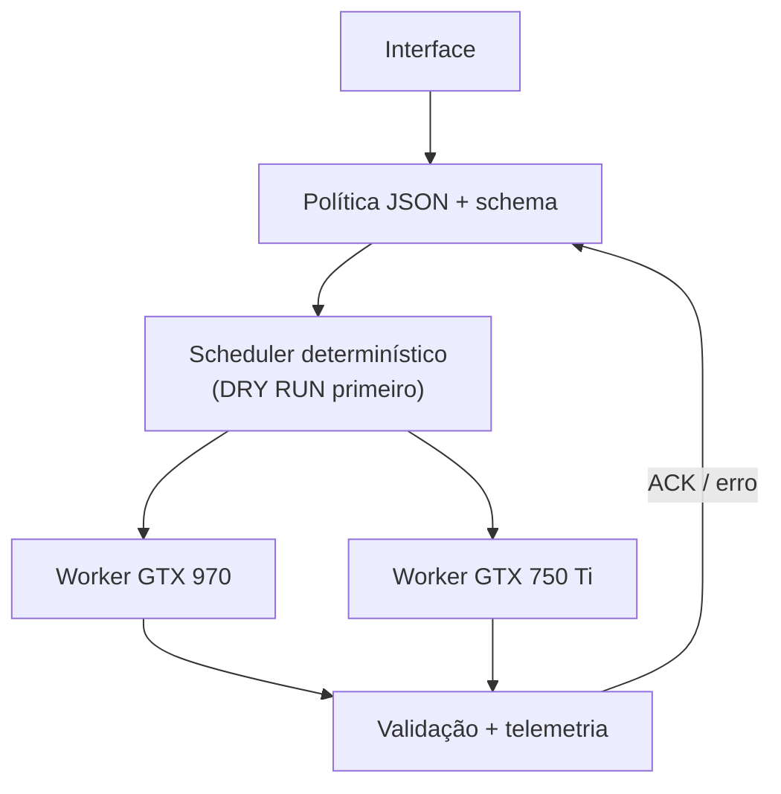

# NEXO GPU CONTROL

**Estado:** interface testada. **Engine inexistente.** Nenhuma tarefa é distribuída entre GPUs por esta interface.

Base: leitura dos arquivos locais da pasta `gpu-switcher/nexo-gpu-control` (README, contrato do Engine, relatório e JSON do self-test, `NexoGpuControl.ps1`). Os fontes **não** foram importados neste PR porque contêm IDs de instância PnP fixos no código; ver "Pendências". Resumo anterior do operador: [progress/nexo-gpu-control-progress-2026-11-19.md](progress/nexo-gpu-control-progress-2026-11-19.md).

## O que é

Uma janela WinForms em PowerShell que:

- mostra telemetria somente leitura (`nvidia-smi` + estado PnP) das duas GPUs a cada 3 s;
- oferece os modos `DUAL_ON`, `DUAL_OFF`, `GTX970_ONLY`, `GTX750TI_ONLY`;
- grava a escolha em `scheduler-policy.json` (com backup do arquivo anterior).

Ela **não** chama `Disable-PnpDevice`, `Enable-PnpDevice`, `pnputil` nem altera registro, BIOS ou driver (conferido por busca no fonte).

## O que NÃO é

| Aparência | Realidade |
|---|---|
| Botão "DUAL GPU ON" | grava `distributionEnabled=true` num JSON. Nada lê esse JSON. |
| Modo "GTX 970 ONLY" | restringe uma lista num JSON. As duas GPUs continuam ligadas. |
| Self-test PASS | os 5 handlers de botão gravaram o JSON esperado. Não houve execução em GPU. |
| Telemetria na tela | leitura do `nvidia-smi`. Não é medição de desempenho. |

## Contrato da política (versão 1)

Campos: `schemaVersion`, `updatedAt`, `mode`, `distributionEnabled`, `primaryGpu`, `allowedAdapters[]` (nome, DeviceId, ID de instância PnP, bus ID), `hardwareDeviceChangesAllowed` (sempre `false`), `engineAcknowledgement` (`PENDING_ENGINE_INTEGRATION`).

## Self-test (2026-11-19 13:53, relatado)

5 cenários, todos PASS: DualOn (2 adaptadores), DualOff, 970Only, 750Only, DualOff com a 750 Ti como principal (1 adaptador cada). `hardwareDeviceChangesAllowed=false` em todos.

## Arquitetura futura proposta

Requisitos mínimos antes de execução real: schema JSON publicado e validado; scheduler que decida por critério medido (não por botão); seleção de GPU por DeviceId/LUID; DRY RUN sem submeter trabalho; ACK do Engine na política.

## Pendências

- Importar o fonte com os IDs PnP substituídos por descoberta em tempo de execução (por DeviceId).
- O `gpu-switcher.ps1` vizinho **pode desabilitar uma GPU** (com travas). Não versionar sem revisão de segurança (auditoria M9).
