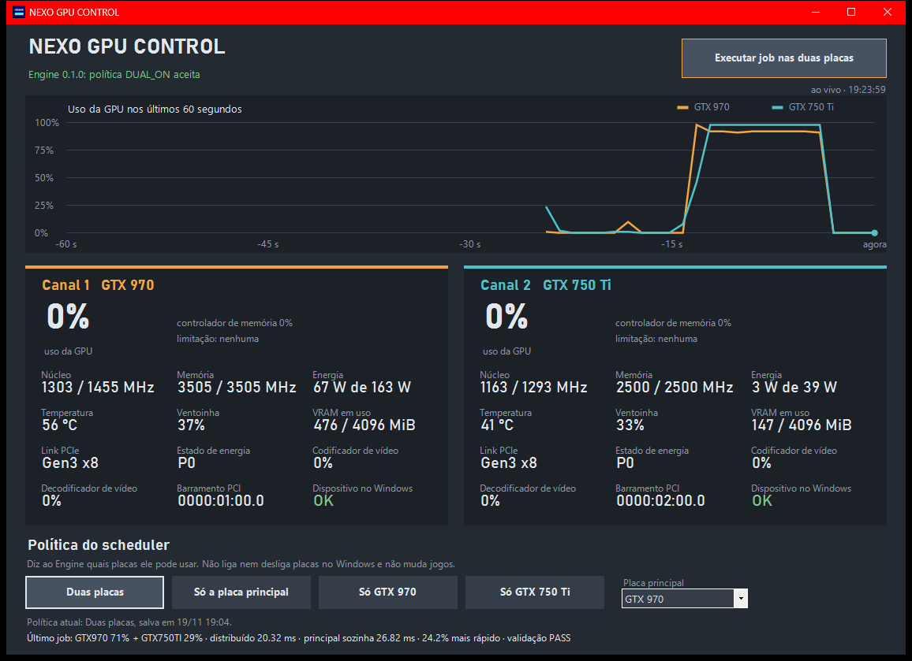
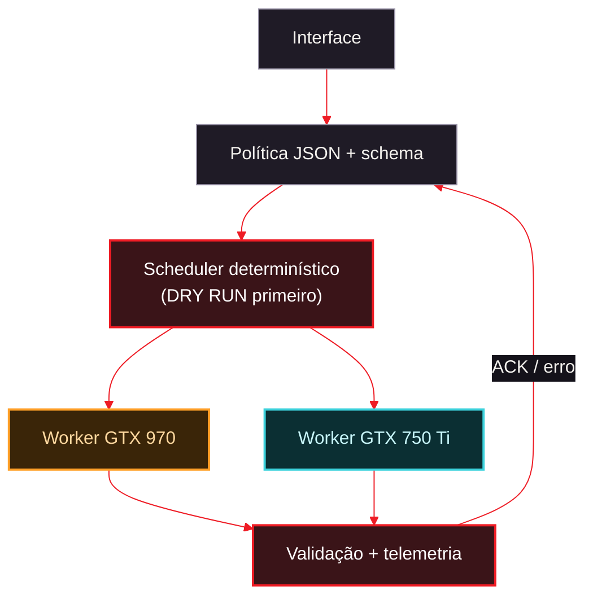

# NEXO GPU CONTROL

**Estado:** v2.0, testada. O [NEXO GPU ENGINE](gpu-engine.md) já consome a política e executa o job do NEXO nas placas permitidas. Jogos continuam fora do alcance da interface.

## v2.0 (2026-11-19)

- Painel de dois canais (GTX 970 em âmbar, GTX 750 Ti em ciano) com uso, uso do controlador de memória, clock do núcleo e da memória (atual/máximo), energia contra o limite, temperatura, ventoinha, VRAM, link PCIe, estado de energia, codificador e decodificador de vídeo, barramento, estado no Windows e motivo de limitação de clock.
- Faixa de histórico com as duas curvas de uso sobrepostas (60 s), atualizada a cada 1 s.
- Botão **Executar job nas duas placas**: roda o Engine (`--run --reps 3 --sustain 10`) e mostra divisão, tempos, ganho e validação.
- Teste 9 do [diário](experiment-log.md): as duas curvas subiram juntas para ~95% por 10 s; 24,2% mais rápido que a GTX 970 sozinha; validação PASS.

Fonte versionado: [`phases/gpu-control/source/NexoGpuControl.ps1`](../phases/gpu-control/source/NexoGpuControl.ps1) (v1.1) e [contrato do Engine](../phases/gpu-control/ENGINE-CONTRACT.md). A v1.1 não tem IDs de instância PnP no código: descobre as placas pelo DeviceId em tempo de execução. Resumo anterior do operador: [progress/nexo-gpu-control-progress-2026-11-19.md](progress/nexo-gpu-control-progress-2026-11-19.md).

## v1.1 — correção do travamento (2026-11-19)

**Problema na v1.0:** a cada 3 s a janela consultava `Get-PnpDevice` para as duas placas dentro da própria interface. Cada consulta levou 7,4 a 8,8 s nesta máquina. Com o PowerShell ocupado, cliques e o fechamento da janela ficavam esperando.

**Correção:** coleta num runspace em segundo plano (timer da interface de 500 ms só aplica resultados prontos); PnP a cada 30 s por consulta CIM filtrada (~2 s, fora da interface); `nvidia-smi` a cada 3 s; placas por DeviceId; instância única por mutex; troca atômica do arquivo de política (`File.Replace`); erros visíveis; no máximo 10 backups. O contrato da política (schemaVersion 1) não mudou.

**Testes (2026-11-19, janelas abertas com política temporária, cliques por `BM_CLICK`):**

| Teste | v1.0 | v1.1 |
|---|---|---|
| Clique → política salva (5 cliques) | 8.859 / 29 / 46 / 12.262 / >30.000 ms | 175 / 32 / 31 / 31 / 31 ms |
| Fechar a janela | >30 s (não fechou) | 87 ms |
| Self-test (5 botões + limite de backups) | 18,9 s, 5/5 PASS | 4,4 s, 6/6 PASS |

Ainda não testado: segunda instância (o aviso abre uma caixa de mensagem que exige clique), uso prolongado por horas.

## O que é

Uma janela WinForms em PowerShell que:

- mostra telemetria somente leitura (`nvidia-smi` + estado PnP) das duas GPUs a cada 3 s;
- oferece os modos `DUAL_ON`, `DUAL_OFF`, `GTX970_ONLY`, `GTX750TI_ONLY`;
- grava a escolha em `scheduler-policy.json` (com backup do arquivo anterior).

Ela **não** chama `Disable-PnpDevice`, `Enable-PnpDevice`, `pnputil` nem altera registro, BIOS ou driver (conferido por busca no fonte).

## O que NÃO é

| Aparência | Realidade |
|---|---|
| Botão "Duas placas" | grava `distributionEnabled=true` na política. O Engine respeita isso nos jobs dele; jogos não. |
| Modo "GTX 970 ONLY" | restringe uma lista num JSON. As duas GPUs continuam ligadas. |
| Self-test PASS | os 5 handlers de botão gravaram o JSON esperado. Não houve execução em GPU. |
| Telemetria na tela | leitura do `nvidia-smi`. Não é medição de desempenho. |

## Contrato da política (versão 1)

Campos: `schemaVersion`, `updatedAt`, `mode`, `distributionEnabled`, `primaryGpu`, `allowedAdapters[]` (nome, DeviceId, ID de instância PnP, bus ID), `hardwareDeviceChangesAllowed` (sempre `false`), `engineAcknowledgement` (`PENDING_ENGINE_INTEGRATION`).

## Self-test (2026-11-19 13:53, relatado)

5 cenários, todos PASS: DualOn (2 adaptadores), DualOff, 970Only, 750Only, DualOff com a 750 Ti como principal (1 adaptador cada). `hardwareDeviceChangesAllowed=false` em todos.

## Arquitetura futura proposta

Requisitos mínimos antes de execução real: schema JSON publicado e validado; scheduler que decida por critério medido (não por botão); seleção de GPU por DeviceId/LUID; DRY RUN sem submeter trabalho; ACK do Engine na política.

## Pendências

- O `gpu-switcher.ps1` vizinho **pode desabilitar uma GPU** (com travas). Não versionar sem revisão de segurança (auditoria M9).
