# NEXO GPU ENGINE

**Versão:** 0.1.0 (2026-11-19). **Estado:** funcional para o job sintético do NEXO; testado na máquina do laboratório.
**Fonte:** [`phases/gpu-engine/source/NexoGpuEngine.cpp`](../phases/gpu-engine/source/NexoGpuEngine.cpp). **Dados:** [`data/gpu-engine/2026-11-19/engine-runs.csv`](../data/gpu-engine/2026-11-19/engine-runs.csv). **Diário:** [experiment-log.md](experiment-log.md).

## O que faz

```mermaid
%%{init: {"theme":"base","themeVariables":{"primaryColor":"#1f1b26","primaryTextColor":"#f4f2ee","primaryBorderColor":"#ee1c25","lineColor":"#ee1c25","secondaryColor":"#2a2533","tertiaryColor":"#1a1720","clusterBkg":"#18151d","clusterBorder":"#77708a","edgeLabelBackground":"#14121a","fontFamily":"Segoe UI, Arial, sans-serif","actorBkg":"#1f1b26","actorBorder":"#ee1c25","actorTextColor":"#f4f2ee","actorLineColor":"#9a94a8","signalColor":"#ee1c25","signalTextColor":"#14121a","noteBkgColor":"#3a1418","noteTextColor":"#f4f2ee","noteBorderColor":"#ee1c25","labelBoxBkgColor":"#1f1b26","labelBoxBorderColor":"#ee1c25","labelTextColor":"#f4f2ee","loopTextColor":"#f4f2ee","activationBkgColor":"#3a1418"}}}%%
flowchart LR
  UI["NEXO GPU CONTROL"] -->|grava| POL["scheduler-policy.json"]
  POL --> ENG["NEXO GPU ENGINE"]
  ENG -->|calibra| CAL["velocidade de cada placa"]
  CAL --> SPLIT["divisão proporcional<br/>(~72/28)"]
  SPLIT --> W0["GTX 970<br/>fila COMPUTE"]
  SPLIT --> W1["GTX 750 Ti<br/>fila COMPUTE"]
  W0 --> V["validação de todos<br/>os elementos no CPU"]
  W1 --> V
  V --> ST["engine-status.json<br/>(ACK + último job)"]
  ST --> UI
  classDef g970 fill:#3a2508,stroke:#ffa028,color:#ffd9a0,stroke-width:2px
  classDef g750 fill:#0b2f33,stroke:#3cd2dc,color:#c8f6fa,stroke-width:2px
  classDef eng fill:#3a1418,stroke:#ee1c25,color:#ffffff,stroke-width:2px
  classDef data fill:#1f1b26,stroke:#9a94a8,color:#f4f2ee,stroke-width:1px
  class UI,POL,ST data
  class ENG,CAL,SPLIT,V eng
  class W0 g970
  class W1 g750
```



1. Lê e valida a política (schemaVersion 1). Recusa política inconsistente ou que peça mudança de hardware.
2. Encontra as GPUs permitidas pelo **DeviceId** (`13C2`, `1380`), nunca pela ordem de enumeração.
3. Sem `--run` (DRY RUN): só responde ACK e mostra o plano; nada é enviado às GPUs.
4. Com `--run`:
   - **calibra** cada placa com 1/8 do job;
   - **divide** o trabalho na proporção da velocidade medida;
   - **compara** o job distribuído com a placa principal sozinha, em ordem ABBA, com uma rodada de aquecimento não cronometrada antes de cada medição;
   - **valida** todos os elementos de todas as rodadas medidas;
   - grava `engine-status.json` e acrescenta uma linha em `engine-runs.csv`.
5. `--sustain S` mantém trabalho distribuído por S segundos depois da medição, só para visualização. Fica fora das estatísticas; a última rodada é validada.

## O que não faz

- Não acelera jogos nem programas de terceiros. Eles decidem sozinhos qual GPU usam.
- Não altera drivers, clocks, dispositivos, registro ou BIOS.
- Não troca dados entre as placas (Cross-Adapter): cada uma devolve sua parte para a RAM.

## Uso

```powershell
NexoGpuEngine.exe                       # DRY RUN
NexoGpuEngine.exe --run                 # job padrão: 8M elementos, 256 iterações, 5 repetições
NexoGpuEngine.exe --run --iterations 1024 --reps 6
NexoGpuEngine.exe --run --reps 3 --sustain 10   # o que o botão do GPU Control executa
```

Precisa de `compute.cso` (o shader da Fase 3) na mesma pasta. Compilação: `phases/gpu-engine/source/build.cmd`.

## Resultados (Teste 8 do diário, válidos)

| Iterações | Divisão 970/750 Ti | Duas placas | GTX 970 sozinha | Ganho |
|---:|:---:|---:|---:|---:|
| 256 | 71/29 | 20,9 ms | 25,7 ms | 18,7% |
| 256 | 72/28 | 20,7 ms | 23,1 ms | 10,3% |
| 1.024 | 75/25 | 50,5 ms | 66,2 ms | 23,7% |
| 1.024 | 74/26 | 53,1 ms | 66,0 ms | 19,5% |

Todas as rodadas tiveram 100% dos elementos validados. Pelas velocidades medidas, o teto teórico é ~25%.

## Limitações

- Job sintético (o mesmo shader determinístico das fases anteriores), 8M elementos.
- 3 a 6 repetições por sessão, poucas sessões, todas no mesmo dia; ainda sem intervalo de confiança.
- O ganho varia com o clock das placas e com outros programas usando a GPU. Execuções com jogo aberto são inválidas (Teste 5).
- A validação no CPU é multithread e leva de 1 a 2 s por rodada; ela fica fora do tempo medido.
